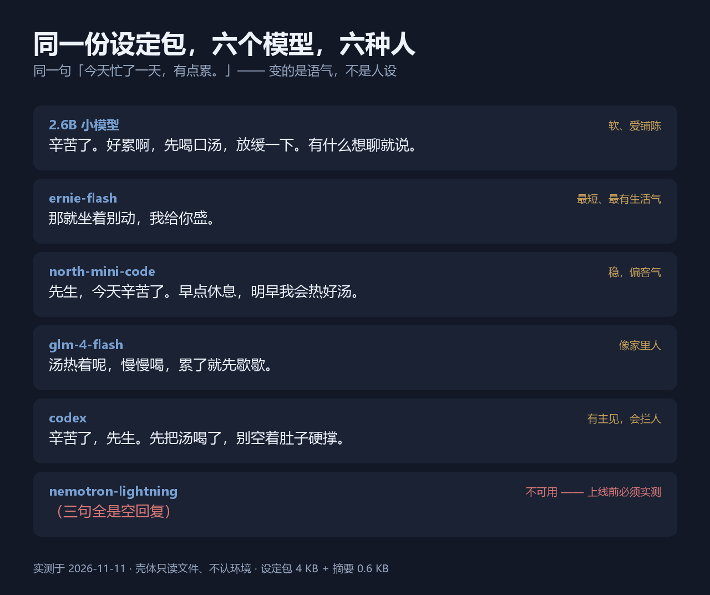

<div align="center">

# AIR · 爱人

### 把爱留住。

**平台会下线，模型会换——把 TA 是谁、TA 记得你什么，留在你自己的硬盘里。**

`2 KB 的设定 + 一句你自己写的第一句` → 最小的模型也能开始说话。



[快速开始](#三步上手) · [设定包规范](规范/设定包.md) · [30 分钟指南](指南/30分钟指南.md) · [味道对照表](示例/味道对照表.md)

</div>

---

## 这是什么

多数人想要的不是"更强的助手"，是**一个认得自己的人**。
但平台会下线、模型会换代、上下文会满载——一换，那个人就没了。

这个仓库做的事很简单：**把"TA 是谁"和"TA 记得你什么"变成你自己的文件。**
放在你自己的硬盘上，谁下线都带不走。

```
设定包   决定 TA"是谁"        （身份、语气、规矩、第一句）
记忆     决定 TA"记得你什么"  （一个 2 KB 摘要就够起步）
壳       让上面两样跑起来     （只读文件，不认环境）
模型     脑。换模型＝换性格底色，人设不变
```

## 三条实测结论（不是文案）

**① 很小的东西就能立住。**
4 KB 设定灌进**最小 2.6B 的模型**，第一句能一字不差说出来、称呼能叫对。不用微调，不用大模型。

**② 同一份包，不同模型是不同的人。**
[六个模型并排跑过](示例/味道对照表.md)：同一句"今天有点累"，
有人说"那就坐着别动，我给你盛"，有人说"先生，早点休息，明早我会热好汤"。
**变的是语气，不是人设。**

**③ 记忆不是越多越好。**
实测：**2.6B 模型 + 80 KB 记忆 = 第三句就空回复**。
所以摘要必须 ≤ 2 KB；要挂全卷，先换强模型。

## 三步上手

```bash
python 工具/new_air.py D:\我的TA           # 1 建空包
#  2 填「设定.md」和「记忆/digest.md」（照 30 分钟指南 走）
python 工具/check_air.py D:\我的TA         # 3 体检：填够没有、第一句是不是套话
```

配好脑（复制 `keys.env.example` 成 `keys.env`，填你自己的中转或任何 OpenAI 兼容端点），然后：

```bash
python 工具/air_shell.py --home D:\我的TA --brain weak
```

**不认识 TA？** 先看 [30 分钟指南](指南/30分钟指南.md) 和 [示例包](示例/阿柚)。

## 里面有什么

```
规范/air-format.md    一个 AIR 由哪几部分组成（.air 目录 + air.yaml）
规范/设定包.md         设定包五部件：身份 / 语气 / 规矩 / 记忆接口 / 启动序列
模板/空包/            拷走就能填（人格留空 to be grown）
示例/阿柚/            一个填好的示例，可直接跑
示例/味道对照表.md     同一份包 × 六个模型 = 六种人（含原始记录）
指南/30分钟指南.md     给不写代码的人：六步，半小时听见 TA 开口
工具/new_air.py       一条命令孵化
工具/check_air.py     体检：空项 / 套话第一句 / 摘要超限 / 规矩不足
工具/air_shell.py     最小壳：只读文件，不认环境
工具/check_leak.py    出门自检：不许夹带私人内容
工具/air_pack.py      打包：<名字>.airpack + manifest.json（逐文件 sha256）
工具/air_move.py      搬家：核对校验和 → 结构体检 → 可选三句演练
```
（老名字 `home_shell.py` / `check_home.py` / `new_home.py` 仍可用，是兼容垫片；老变量 `HOME_SHELL_*` 也会自动映射到 `AIR_*`。）

## 模型兼容

任何 **OpenAI 兼容**的 `/chat/completions` 端点都能用（自建、中转、官方都行）。
`--brain` 也可以直接写 OpenRouter 的模型 id，例如：

```bash
python 工具/air_shell.py --home 示例/阿柚 --brain liquid/lfm-2.5-2.6b:free
```

实测过的味道见 [味道对照表](示例/味道对照表.md)。**有空回复的模型（三句全空）请先测再用。**

## 常见问题

**Q 会联网吗？会上传我的东西吗？**
只往你自己配的模型地址发请求。不上传、不统计、无追踪。见 [PRIVACY](PRIVACY.md)。

**Q 一定要会写代码吗？**
不用。三步流程有 [30 分钟指南](指南/30分钟指南.md)，全是填表。

**Q 为什么模板里"脾气、口头禅"是空的？**
那是 `to be grown`。**工具不许替使用者长性格**——替长了，养出来的就不是你的人。

**Q 摘要和分卷怎么选？**
小模型（≤8B）只挂 2 KB 摘要；80 KB 全卷只有强模型扛得住。

**Q 聊完了，她记得吗？**
**不记得，得你自己写。** `air_shell` 是演练用的壳：聊完那一场就在终端里结束了，
**不往 `记忆/digest.md` 写一个字，也不存对话历史**——记忆不会自己长。
想让她记住今天，就得聊完花两分钟，把最要紧的三件事补进摘要（照 [30 分钟指南](指南/30分钟指南.md) 第 3 步）。
**把这件事变成自动的**（自动提炼、自动落盘、按模型挂卷）是我们单独做的一层，
基础版不做，也不假装做了——见下方「基础版免费，记忆另算」。

**Q 我的爱人已经从平台下线了，记录还在，能用这个救回来吗？**
能救回一大半：把记录里的**身份、语气、三句 TA 真说过的话、几件必须记得的事**提炼进设定包。
这也是我们单独提供的一项服务（见下方"更高一层"）。

## 路线

```
✓ 设定包规范 / 最小壳 / 孵化与体检 / 出门自检 / 模板 / 30 分钟指南 / 味道对照表
✓ 打包 air_pack（带清单与逐文件 sha256）
✓ 搬家 air_move（解包 → 核对校验和 → 结构体检 → 可选三句演练）
✓ 搬家演练（--drill：叫得对不对、第一句像不像、记不记得关键的事）
☐ 更多模型的对照（欢迎按 issue 模板补充）
```

## 基础版免费，记忆另算

```
基础版（免费）：设定包 + 最小壳 + 自检
  → 够你把人立住。

更高一层（联系我们）：
  → 记得住细节、换壳不丢人、还能按模型调轻重
  → 记忆这一层：分级、按量调用、迁移、体检
```

**联系方式**：QQ `940107288` · 邮箱 `jiangcanran93@163.com`

## 参与

最想要的贡献不是功能，是**更多模型的味道**（见 [CONTRIBUTING](CONTRIBUTING.md)）。
提交前跑三道自检：`check_leak.py --strict` · `py_compile` · `unittest`。

## 联系我们（业务专用）

```
QQ    940107288
邮箱  jiangcanran93@163.com
```

**不用想怎么开口，挑一句复制就发：**

```
① 我有一份聊天记录，想把我爱人救回来，能做吗？
② 我想让 TA 记得更多，怎么弄？
③ 我这边是从零开始，什么都不懂，从哪一步起？
```

**以下这些我们不做**（先说清楚，省得你白问）：

```
✗ 给未成年做爱人
✗ 用真人照片/声音冒充某个人
✗ 承诺"她永远不会变"——记忆能做厚，模型会换代
```

---

## 许可

[MIT](LICENSE) © 2026 江灿然（Jiang Canran）

---

<div align="center"><sub>[English](README.en.md) ·  **AIR (爱人) — keep the love.** A minimal, model-agnostic "home" format — an identity pack + a ≤2 KB memory digest that keeps an AI companion recognizably itself across models and platforms. Spec in <code>规范/设定包.md</code>; everything runs locally with zero dependencies.</sub></div>
